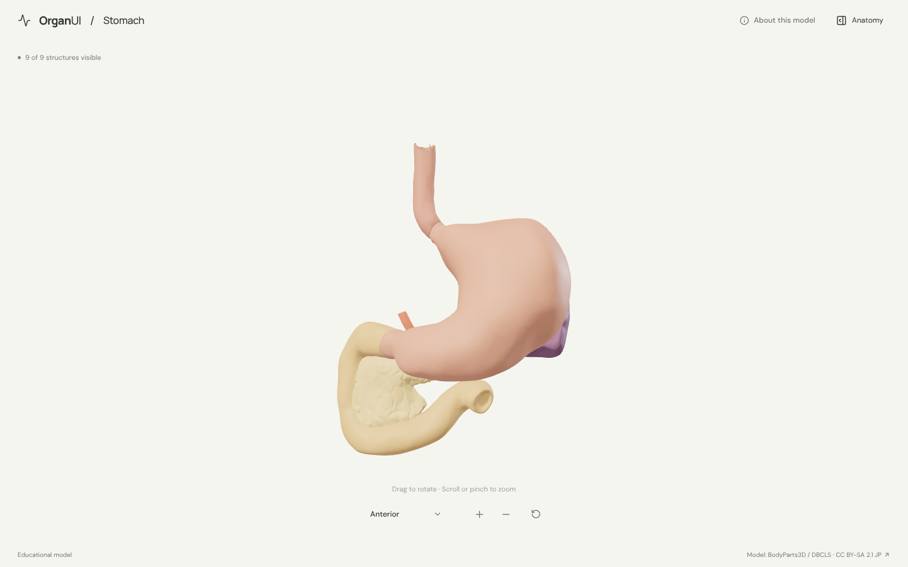
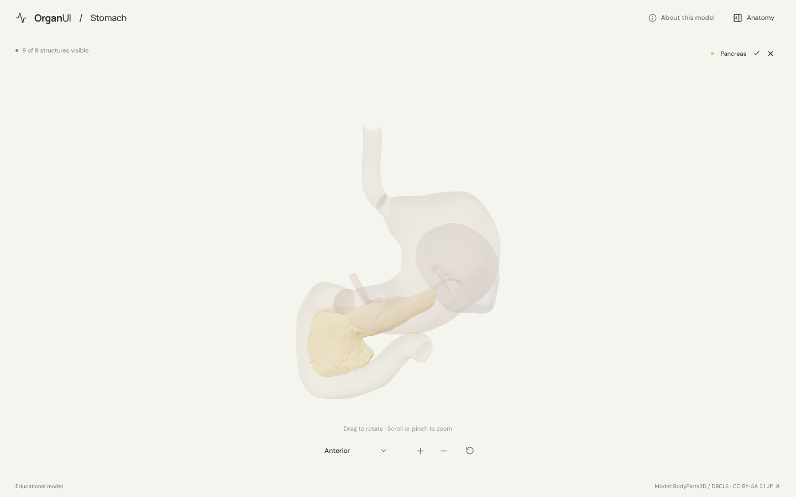
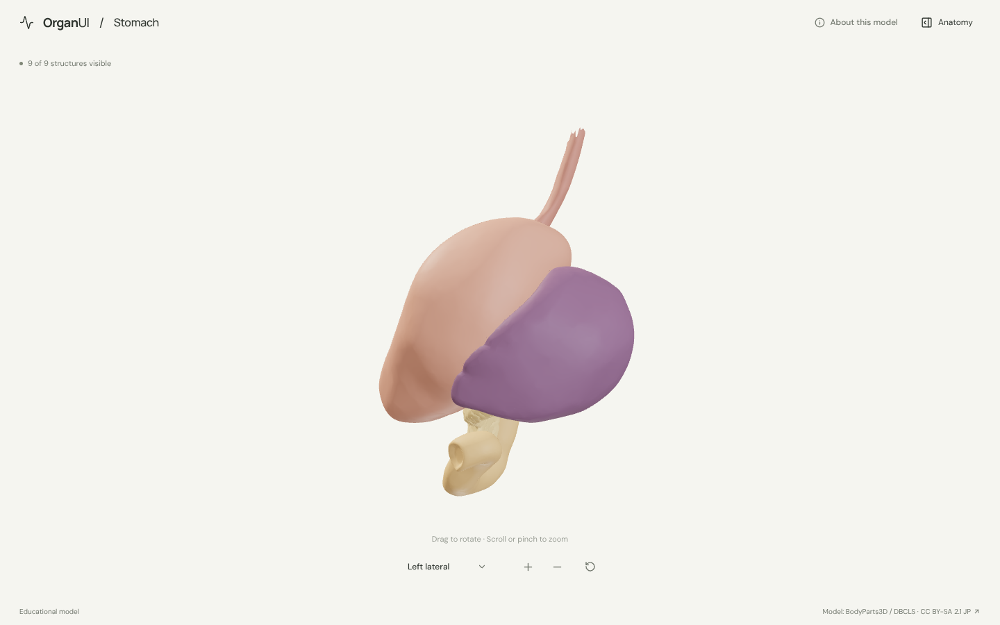
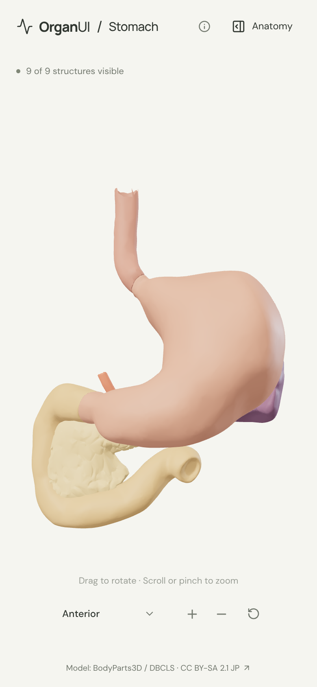
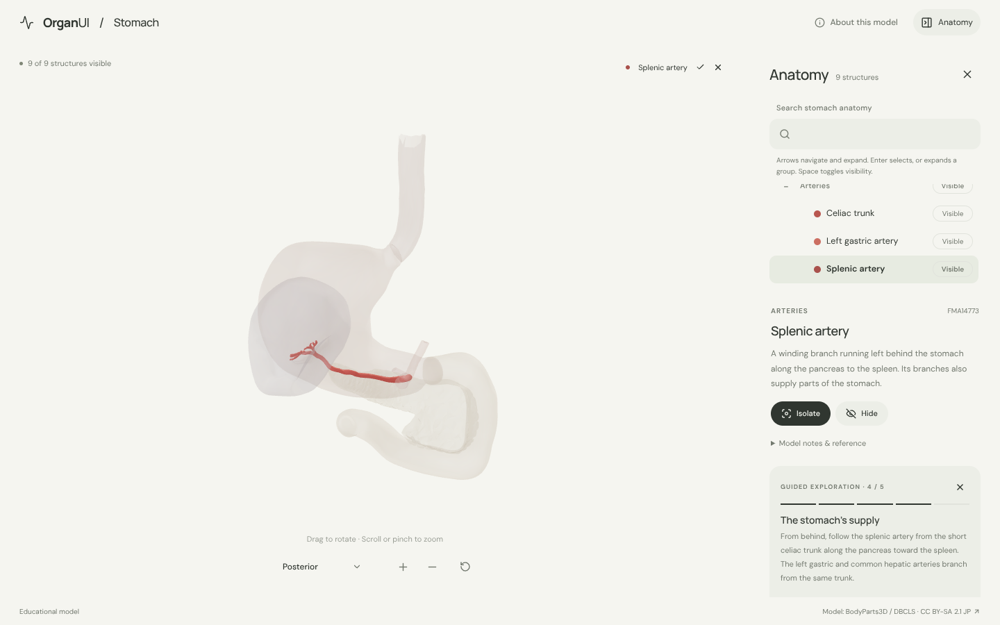

# OrganUI Stomach

A minimal, standalone, open-source stomach anatomy explorer built with React, TypeScript, Three.js, React Three Fiber, Vite, and Bun. It shares its selection, framing, panel and toolbar behaviour with [OrganUI Heart](https://github.com/organui/heart-3d).

**Status:** working local demo. Nine selectable structures, a real bundled model, responsive layouts, and desktop/mobile interactions checked in Chromium. Public deployment and clinical anatomy review have not been completed.



## Run locally

Install [Bun](https://bun.sh/) **1.4.2 or newer**, then:

```sh
git clone https://github.com/organui/stomach-3d.git
cd stomach-3d
bun install --frozen-lockfile
bun run dev
```

Open **http://127.0.0.1:5173**. No environment variables, accounts, API keys, sibling repositories, model downloads, or external font services are needed after dependency installation. The ready-to-use 1.2 MB GLB is in `public/models/`.

```sh
bun run typecheck       # TypeScript checks, including conversion scripts
bun run test            # Unit tests for selection emphasis, picking, and the anatomy-tree adapter
bun run verify:model    # Check the GLB hash, source IDs, and valid geometry
bun run build           # Typecheck and create dist/
bun run preview         # Serve the production build at http://127.0.0.1:4173
bun run format:check    # Check formatting of application and preparation code
```

The app is static and uses relative build paths. No deployment has been performed.

## Explore

- The stomach opens in an anterior view with the lower esophagus, duodenum, pancreas and spleen around it. Expand **Anatomy** to browse structures.
- Drag to rotate; scroll or pinch to zoom. The view menu offers anterior, posterior and left lateral presets; manual rotation changes its label to **Custom view**.
- Select a mesh or a row in the anatomy tree (the OrganUI registry `anatomy-tree` component). The selection glows in its own colour and everything else is ghosted, so the celiac branches and pancreas stay visible behind the stomach.
- Isolate a structure, hide it, or restore all. **Reset explorer** restores camera, visibility, selection, tree state and tour.
- Follow five guided stops: the stomach, where food arrives and leaves, its arterial supply, and its neighbours on the left.
- On mobile, **Anatomy** opens the tree below the model; **View in 3D** returns to it. Escape closes the panel and returns focus to its toggle.

<details>
<summary>Selection, left lateral, mobile and guided exploration screenshots</summary>









</details>

## Model, credits, and review status

> BodyParts3D, © The Database Center for Life Science licensed under CC Attribution-Share Alike 2.1 Japan.

The model is a curated subset of **BodyParts3D 3.0**, taken from a public GitHub mirror pinned by commit and checksum. The anatomy model and images of it are licensed **[CC BY-SA 2.1 Japan](https://creativecommons.org/licenses/by-sa/2.1/jp/deed.en)**, separately from this repository's **MIT code license**. Read [model provenance and preparation](docs/MODEL_PROVENANCE.md), [asset attribution](public/models/ATTRIBUTION.md), and the [checksum/mapping manifest](public/models/manifest.json).

| Group | Structures |
| --- | --- |
| Digestive tract | Stomach, esophagus (lower part), duodenum |
| Arteries | Celiac trunk, left gastric, splenic, and common hepatic arteries |
| Neighbouring organs | Spleen, pancreas |

Names were checked against the dataset's FMA labels and the geometry was inspected. **Expert anatomical review is pending.** This is an educational interface demonstration, not a diagnostic, treatment, measurement, or physiological simulation tool.

Known limitations:

- **The stomach is one source mesh.** Its regions (cardia, fundus, body, pyloric part) and wall layers cannot be selected separately.
- The esophagus is trimmed to its lowest ~8 cm; vessel ends are truncated. The liver, diaphragm, aorta, veins, omenta and smaller gastric arteries are omitted.
- This is a simplified adult male reference model; colours are illustrative.
- Browser checks used desktop Chromium and mobile viewport sizes, not physical devices or a screen-reader audit.

## Implementation

- `src/anatomy.ts`: source-ID mappings, explanatory text, and guided stops.
- `src/App.tsx`, `src/Viewer.tsx`, `src/ViewMenu.tsx`, `src/SceneCanvas.tsx`: interface, viewer and camera, shared with the heart explorer.
- `src/framing.ts`: identical copy of the shared OrganUI framing helpers.
- `src/components/ui/anatomy-tree.tsx`: OrganUI registry component installed with the shadcn CLI; tracked unmodified. See [registry integration](docs/REGISTRY_INTEGRATION.md).
- `src/anatomy-adapter.ts`: tree data and visibility conversion for this scene.
- `scripts/`: pinned source inputs, reproducible STL-to-GLB conversion, and runtime validation.

## License

Original application code: [MIT](LICENSE). Anatomy model, derived model images, fonts, and icons retain their separately documented licenses.

Part of [OrganUI](https://github.com/organui).
